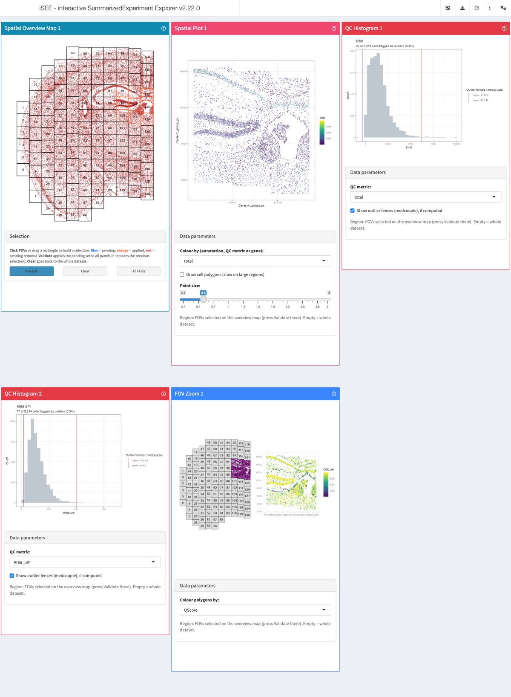

# iseeSpatial

Interactive exploration of cell-resolution spatial transcriptomics (CosMx,
Xenium, cell-segmented Visium HD) with
[iSEE](https://bioconductor.org/packages/iSEE). The data are a standard
`SpatialExperiment`.

Select a region on an overview map (fields of view for CosMx, cells for the
other platforms) and every panel follows: spatial plots, quality-control
histograms, spatial statistics, spatially variable genes, cellular niches
and spatial domains. Heavy analyses run only when *Compute* is pressed, on
the selected region, and plots are cached so views already seen reopen at
once.



## Installation

```r
if (!requireNamespace("BiocManager", quietly = TRUE))
    install.packages("BiocManager")
BiocManager::install("iseeSpatial")
```

The development version, from this repository:

```r
BiocManager::install("emiledvn/iseeSpatial-modular")
```

## Quick start

```r
library(iseeSpatial)
spe <- loadXenium("path/to/xenium/outs")   # or loadCosmx(), loadVisiumHD()
app <- iseeSpatial(spe)                    # or mode = "qc" for raw data
shiny::runApp(app)
```

Any `SpatialExperiment` with spatial coordinates works.

## Documentation

* *Get started with iseeSpatial*: installation, a small CosMx example and
  the list of panels, `vignette("iseeSpatial", package = "iseeSpatial")`.
* *CosMx workflow: the mouse dentate gyrus*: quality control of a whole
  section, cell polygons, niches, spatial domains and the apps,
  `vignette("cosmx_dentate_gyrus", package = "iseeSpatial")`.
* Scripts in `system.file("scripts", package = "iseeSpatial")`: the OSTA
  book workflows for Xenium and Visium HD made ready for the app, and the
  precomputation of niches and domains on a full dataset.

## Issues

Questions and bug reports:
[GitHub issues](https://github.com/emiledvn/iseeSpatial-modular/issues) or
the [Bioconductor support site](https://support.bioconductor.org) (tag
`iseeSpatial`).
