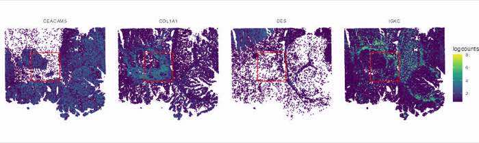
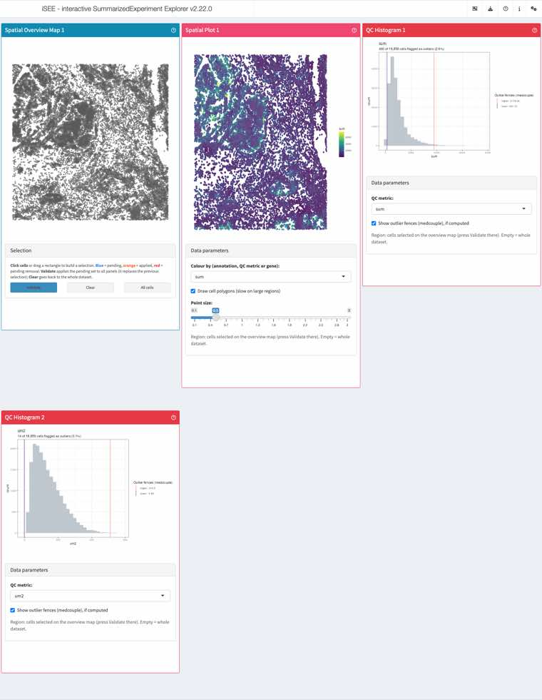
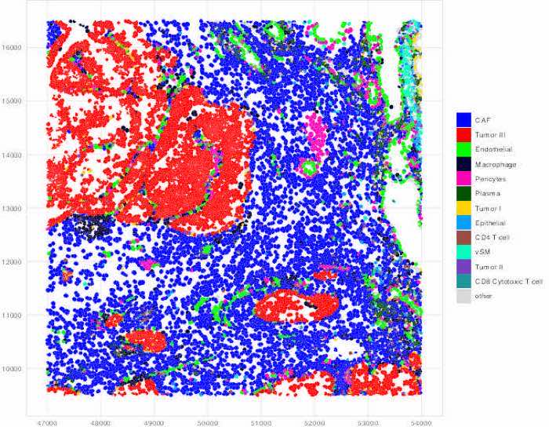
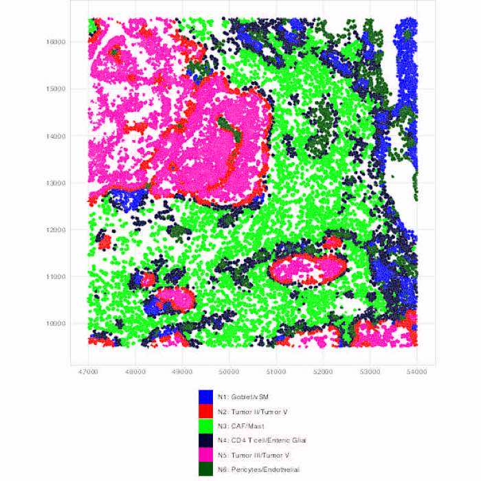
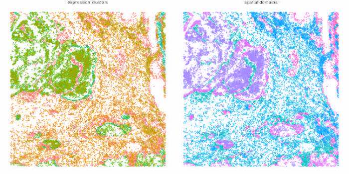
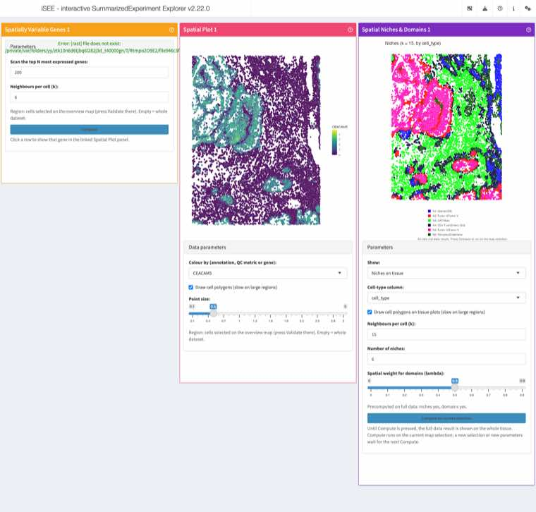

```{r setup, include = FALSE}
# The dataset is 885 MB: the code is shown but not run when the vignette
# is built. The figures come from running the same code locally
# (data-raw/visiumhd_vignette.R in the source package).
knitr::opts_chunk$set(collapse = TRUE, comment = "#>", eval = FALSE)
```

# Overview

Visium HD measures the whole transcriptome on a 2 µm grid; Space Ranger
segments cells and assigns the grid squares to them. This gives
sequencing-based data at cellular resolution, with about 18,000 genes per
cell instead of a few hundred in imaging panels. This vignette uses a
section of human colorectal cancer (Oliveira et al. 2025), as in the
[OSTA book](https://lmweber.org/OSTA/), distributed by
`r BiocStyle::Biocpkg("OSTA.data")` with a matching single-cell reference.

**The code below is not run when the vignette is built**: the data take
885 MB. All the figures were produced by running exactly this code; the
script is `data-raw/visiumhd_vignette.R` in the source package. A
complete reproduction of the OSTA chapter, with app-ready objects, is in
`system.file("scripts", "visiumhd_osta_workflow.R", package = "iseeSpatial")`.

# Reading the data

`load_visiumhd()` reads the cell-segmented outputs with
`r BiocStyle::Biocpkg("VisiumIO")`, uses gene symbols as row names and
records the platform. The counts stay on disk (HDF5) until needed.

```{r read}
library(iseeSpatial)
library(SpaceTrooper)
library(SingleR)
library(ggplot2)

wd <- getwd()
zip <- OSTA.data::OSTA.data_load("VisiumHD_HumanColon_Oliveira")
setwd(wd)    # OSTA.data_load() changes the working directory
dir <- tempfile()
unzip(zip, exdir = dir)
seg <- file.path(dir, "segmented_outputs")
spe <- load_visiumhd(seg)
#> Visium HD: 220703 cells, 18132 genes
```

```{r section}
xy <- spatialCoords(spe)
markers <- c("CEACAM5", "COL1A1", "DES", "IGKC")
df <- do.call(rbind, lapply(markers, function(g) {
    v <- as.numeric(logcounts(spe)[g, ])
    data.frame(x = xy[, 1], y = xy[, 2], gene = g, logcounts = v)[v > 0, ]
}))
box <- data.frame(xmin = 47000, xmax = 54000, ymin = 9500, ymax = 16500)
ggplot(df, aes(x, y, colour = logcounts)) +
    geom_point(size = 0.01) +
    geom_rect(data = box, inherit.aes = FALSE, colour = "red", fill = NA,
              aes(xmin = xmin, xmax = xmax, ymin = ymin, ymax = ymax)) +
    facet_wrap(~gene, nrow = 1) +
    scale_colour_viridis_c() +
    coord_fixed() +
    theme_void()
```

```{r fig-section, echo = FALSE, eval = TRUE, fig.cap = "The whole section: tumour (CEACAM5), stroma (COL1A1), smooth muscle (DES) and plasma cells (IGKC). The red box is the region studied below."}

```

# A region of tumour and stroma

We keep the region in the red box (about 19,000 cells), bring its counts
into memory and normalise them.

```{r region}
in_box <- xy[, 1] > 47000 & xy[, 1] < 54000 & xy[, 2] > 9500 & xy[, 2] < 16500
roi <- spe[, in_box]
counts(roi) <- as(counts(roi), "dgCMatrix")
roi <- scuttle::logNormCounts(roi)
```

## Cell polygons

Space Ranger writes the cell outlines to `cell_segmentations.geojson`.
Stored in a `polygons` column, they are drawn by the spatial panels and by
`SpaceTrooper::plotPolygons()`, and give the cell area:

```{r polygons}
polys <- sf::st_read(file.path(seg, "cell_segmentations.geojson"),
                     quiet = TRUE)
id <- as.integer(sub("cellid_0*([0-9]+)-1", "\\1", colnames(roi)))
# Same layout as SpaceTrooper's polygons (an sf table, geometry "global")
roi$polygons <- sf::st_sf(
    cell_id = id, global = sf::st_geometry(polys)[match(id, polys$cell_id)])
um_per_px <- jsonlite::fromJSON(
    file.path(seg, "spatial", "scalefactors_json.json"))$microns_per_pixel
roi$um2 <- as.numeric(sf::st_area(sf::st_set_crs(roi$polygons, NA))) *
    um_per_px^2
summary(roi$um2)
#>    Min. 1st Qu.  Median    Mean 3rd Qu.    Max.
#>   3.993  75.864 123.778 141.102 191.844 579.148
```

## Quality control

```{r qc}
roi <- scuttle::addPerCellQCMetrics(roi,
    subsets = list(mito = grepl("^MT-", rownames(roi))))
roi <- computeSpatialOutlier(roi, computeBy = "sum", method = "mc")
roi <- computeSpatialOutlier(roi, computeBy = "um2", method = "mc")
roi$high_mito <- scuttle::isOutlier(roi$subsets_mito_percent,
                                    type = "higher")
table(counts = roi$sum_outlier_mc)
#>  HIGH   LOW    NO
#>   209   281 18369
```

The QC app shows the counts on the polygons and the histograms of counts
and cell area with their outlier fences; any other metric (here
`subsets_mito_percent`) can be chosen in the panels:

```{r app-qc}
app <- iseeSpatial(roi, mode = "qc")
```

```{r fig-qc, echo = FALSE, eval = TRUE, fig.cap = "QC app on the region: UMI counts per cell on the polygons, and histograms of counts and cell area with their outlier fences."}

```

```{r filter}
cells <- roi[, roi$sum_outlier_mc == "NO" & roi$um2_outlier_mc == "NO" &
                !roi$high_mito]
```

## Cell types from a single-cell reference

The Chromium data of the same study serve as reference for
`r BiocStyle::Biocpkg("SingleR")`, with up to 500 cells per type and
pseudo-bulk profiles (`aggr.ref = TRUE`) to keep it fast (about 30 s):

```{r singler}
wd <- getwd()
ref_zip <- OSTA.data::OSTA.data_load("Chromium_HumanColon_Oliveira")
setwd(wd)
ref_dir <- tempfile()
unzip(ref_zip, exdir = ref_dir)
ref <- DropletUtils::read10xCounts(
    file.path(ref_dir, "filtered_feature_bc_matrix.h5"), col.names = TRUE)
md <- read.csv(file.path(ref_dir, "cell_metadata.csv"), row.names = 1)
colData(ref)[names(md)] <- md[colnames(ref), ]
rownames(ref) <- make.unique(rowData(ref)$Symbol)
ref <- ref[, ref$QCFilter == "Keep"]
idx <- split(seq_len(ncol(ref)), ref$Level2)
idx <- lapply(idx, function(i) i[sample.int(length(i), min(length(i), 500))])
ref <- ref[, unlist(idx)]
counts(ref) <- as(counts(ref), "dgCMatrix")
ref <- scuttle::logNormCounts(ref)

res <- SingleR(test = cells, ref = ref, labels = ref$Level2,
               aggr.ref = TRUE)
cells$cell_type <- factor(res$pruned.labels)
cells <- cells[, !is.na(cells$cell_type)]
head(sort(table(cells$cell_type), decreasing = TRUE), 8)
#>        CAF  Tumor III Endothelial Macrophage  Pericytes     Plasma
#>       6948       6689         900        822        712        452
#>    Tumor I Epithelial
#>        303        206
```

```{r celltypes}
top <- names(sort(table(cells$cell_type), decreasing = TRUE))[1:12]
cells$cell_type_top <- factor(ifelse(cells$cell_type %in% top,
                                     as.character(cells$cell_type), "other"),
                              levels = c(top, "other"))
pal <- c(setNames(unname(pals::glasbey(12)), top), other = "grey85")
plotPolygons(cells, colourBy = "cell_type_top", palette = pal,
             sampleId = NULL)
```

```{r fig-celltypes, echo = FALSE, eval = TRUE, fig.cap = "Cell types on the cell polygons: tumour glands (red) in a stroma of cancer-associated fibroblasts (blue), lined by endothelial cells and pericytes."}

```

# Niches and spatial domains

```{r niches}
cells <- buildSpatialGraph(cells, k = 15)
cells <- computeNiches(cells, label_col = "cell_type", k = 15, n_niches = 6)
table(cells$niche)
```

```{r fig-niches, echo = FALSE, eval = TRUE, fig.cap = "Niches: tumour cores, the tumour border, the fibroblast stroma, a perivascular niche and an immune niche."}

```

With 18,000 genes, the PCA for spatial domains is run on the 2,000 most
variable genes; the variances are computed on the sparse matrix:

```{r domains}
x <- logcounts(cells)
m <- Matrix::rowMeans(x)
v <- Matrix::rowMeans(x^2) - m^2
hvg <- names(sort(v, decreasing = TRUE))[1:2000]
pca <- prcomp(t(as.matrix(x[hvg, ])), rank. = 20)
reducedDim(cells, "PCA") <- pca$x
cells <- computeSpatialDomains(cells, k_spatial = 15, lambda = 0.5,
                               resolution = 0.5)
```

```{r fig-domains, echo = FALSE, eval = TRUE, fig.cap = "Expression clusters (left) and spatial domains (right)."}

```

# The analysis app

```{r app}
app <- iseeSpatial(cells, mode = "analysis")
if (interactive()) shiny::runApp(app)
```

Gene menus are searchable and list the most expressed genes first, so the
18,000 genes stay usable. The spatially variable gene ranking scans the
200 most expressed genes of the selected region by default (`TopN` in the
panel).

```{r fig-app, echo = FALSE, eval = TRUE, fig.cap = "Spatially variable genes of the region (left): immunoglobulins (plasma cells), collagens (fibroblasts), CEACAM5 and MUC12 (tumour). CEACAM5 on the polygons (middle) and the niches (right)."}

```

The ranking recovers the structures of the region without any
annotation: plasma cell immunoglobulins (*IGKC*, *IGHG1*), the fibroblast
collagens (*COL3A1*, *COL1A1*), and tumour genes (*CEACAM5*, *MUC12*).
Clicking a gene shows it on the polygons.

## Saving the objects

```{r save}
saveRDS(roi, "visiumhd_region_unfiltered.rds")   # QC app
saveRDS(cells, "visiumhd_region.rds")            # analysis app
app <- iseeSpatial(readRDS("visiumhd_region.rds"))
```

# Session information

The figures were made with:

```{r session-info, eval = TRUE, echo = FALSE}
cat("R 4.5.2, iseeSpatial 0.99.0, SpaceTrooper 1.0.1, SingleR,",
    "VisiumIO, OSTA.data 1.2.1 (macOS).\n")
```
