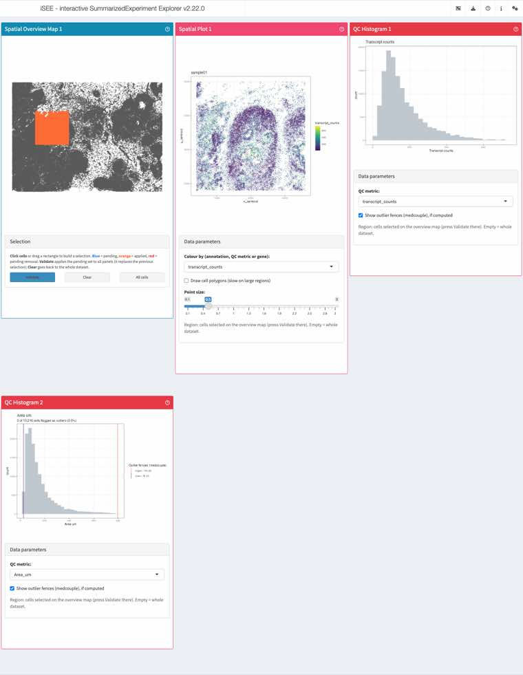
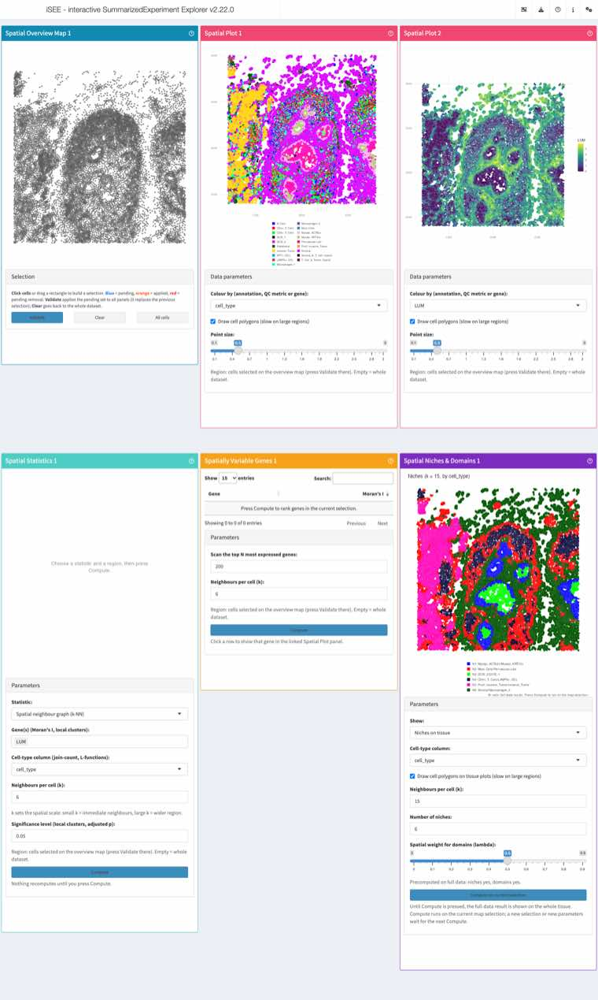
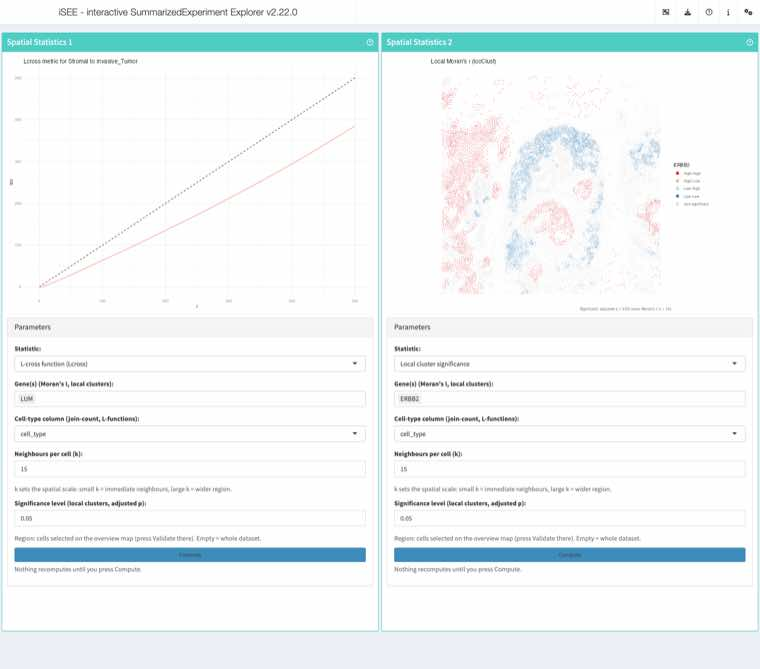

```{r setup, include = FALSE}
# JPEG figures at screen resolution keep the built vignette small.
knitr::opts_chunk$set(collapse = TRUE, comment = "#>", fig.width = 7,
                      fig.height = 5, message = FALSE, dev = "jpeg",
                      dev.args = list(quality = 50), dpi = 60,
                      fig.retina = 1)
```

# Overview

Xenium data have no fields of view: regions are selected cell by cell, by
clicking or brushing on the overview map. This vignette uses a Xenium
section of human breast cancer with about 168,000 cells and 313 genes
([Janesick et al. 2023](https://doi.org/10.1038/s41467-023-43458-x)),
distributed by `r BiocStyle::Biocpkg("OSTA.data")` (about 40 MB) with a
cell-type annotation. It shows:

1. reading a Xenium bundle with `loadXenium()`, with cell polygons;
2. quality control of the whole section, in static plots and in the QC app;
3. a region where ductal carcinoma in situ (DCIS) meets invasive tumour,
   with its immune and stromal surroundings;
4. niches, spatial domains and cell-type co-localisation;
5. the analysis app on this region.

# Reading the data

```{r download}
library(iseeSpatial)
library(SpaceTrooper)
library(ggplot2)

zip <- OSTA.data::OSTA.data_load("Xenium_HumanBreast1_Janesick",
                                 mol = FALSE)
dir <- tempfile()
unzip(zip, exdir = dir)
list.files(dir)
```

`loadXenium()` reads the counts, the cell metadata and the cell
boundaries, adds `logcounts` and records the platform:

```{r read}
spe <- loadXenium(dir)
spe
```

The annotation matches cells by their Xenium cell id:

```{r labels}
ann <- read.csv(file.path(dir, "annotation.csv"))
spe$cell_type <- ann$Annotation[match(spe$cell_id, ann$Barcode)]
sort(table(spe$cell_type, useNA = "ifany"), decreasing = TRUE)
```

```{r section, fig.cap = "The whole section coloured by cell type.", fig.height = 5.5, fig.width = 9}
df <- data.frame(spatialCoords(spe), cell_type = spe$cell_type)
names(df)[1:2] <- c("x", "y")
ggplot(df, aes(x, y, colour = cell_type)) +
    geom_point(size = 0.05) +
    scale_colour_manual(values = unname(pals::glasbey(20)),
                        na.value = "grey80") +
    coord_fixed() +
    theme_void() +
    theme(legend.text = element_text(size = 7), legend.title = element_blank()) +
    guides(colour = guide_legend(override.aes = list(size = 2)))
```

Invasive tumour fills the left part of the section; DCIS ducts, ringed by
myoepithelial cells, lie in the middle and on the right.

# Quality control of the whole section

`r BiocStyle::Biocpkg("SpaceTrooper")` computes per-cell metrics from the
counts and the negative controls (probes, codewords, blanks). Xenium
gives the cell area in µm² but no aspect ratio, hence the warning below.

```{r qc}
S4Vectors::metadata(spe)$technology <- "10X_Xenium"
spe$Area_um <- spe$cell_area
spe <- spatialPerCellQC(spe)
spe <- computeSpatialOutlier(spe, computeBy = "total", method = "mc")
spe <- computeSpatialOutlier(spe, computeBy = "Area_um", method = "mc")
table(total = spe$total_outlier_mc, area = spe$Area_um_outlier_mc)
```

```{r qc-hist, fig.cap = "Transcripts per cell and cell area, with the outlier fences.", fig.height = 3.2, fig.show = "hold", out.width = "49%"}
plotMetricHist(spe, metric = "total", useFences = "total_outlier_mc")
plotMetricHist(spe, metric = "Area_um", useFences = "Area_um_outlier_mc")
```

```{r qc-map, fig.cap = "Transcripts per cell over the section (log scale).", fig.height = 5.5}
spe$log10_total <- log10(spe$total + 1)
plotCentroids(spe, colourBy = "log10_total", size = 0.05)
```

## The QC app

```{r app-qc}
app <- iseeSpatial(spe, mode = "qc", cache = FALSE)
if (interactive()) shiny::runApp(app)
```

On the overview map, every cell is a point. Clicking adds a cell to the
selection, and the box tool (drag) adds all the cells in a rectangle;
*Validate* applies the selection to every panel. Cell polygons are drawn
by default for datasets of up to 20,000 cells; for larger ones, as here,
tick *Draw cell polygons* in a panel once a region is selected.

```{r shot-qc, echo = FALSE, fig.cap = "QC app on the whole section (168,000 cells) with the region of this vignette selected on the map (orange): transcript counts and histograms with outlier fences, for the selected cells only."}

```

# A region of DCIS and invasive tumour

We keep a 1.6 mm × 1.6 mm region with two DCIS ducts, invasive tumour,
stroma and immune cells, and remove outliers, cells with fewer than 10
transcripts and unannotated cells.

```{r region}
xy <- spatialCoords(spe)
in_region <- xy[, 1] > 1200 & xy[, 1] < 2800 & xy[, 2] > 2400 & xy[, 2] < 4000
keep <- in_region & spe$total >= 10 &
    spe$total_outlier_mc == "NO" & spe$Area_um_outlier_mc == "NO" &
    !is.na(spe$cell_type) & spe$cell_type != "Unlabeled"
roi <- spe[, keep]
roi$cell_type <- factor(roi$cell_type)
roi <- setPlatform(roi, "xenium")
ncol(roi)
```

```{r roi-polygons, fig.cap = "The region: cell polygons coloured by cell type.", fig.height = 7, fig.width = 9}
pal <- setNames(unname(pals::glasbey(nlevels(roi$cell_type))),
                levels(roi$cell_type))
plotPolygons(roi, colourBy = "cell_type", palette = pal, sampleId = NULL) +
    theme(legend.text = element_text(size = 7))
```

## Marker genes

*CEACAM6* marks DCIS, *ERBB2* both tumour compartments, *KRT14* the
myoepithelial ring, *CD8A* cytotoxic T cells, *MS4A1* B cells and *LUM*
fibroblasts.

```{r markers, fig.cap = "Marker genes.", fig.height = 6, fig.width = 10}
markers <- c("CEACAM6", "ERBB2", "KRT14", "CD8A", "MS4A1", "LUM")
xy <- spatialCoords(roi)
df <- do.call(rbind, lapply(markers, function(g)
    data.frame(x = xy[, 1], y = xy[, 2], gene = g,
               logcounts = logcounts(roi)[g, ])))
df$gene <- factor(df$gene, markers)
ggplot(df, aes(x, y, colour = logcounts)) +
    geom_point(size = 0.15) +
    facet_wrap(~gene, nrow = 2) +
    scale_colour_viridis_c() +
    coord_fixed() +
    theme_void()
```

The DCIS ducts are surrounded by a continuous myoepithelial layer
(*KRT14*), which the invasive tumour has lost. B cells gather in clusters
in the stroma, while CD8 T cells are spread more evenly.

# Niches, domains and co-localisation

```{r niches}
roi <- buildSpatialGraph(roi, k = 15)
roi <- computeNiches(roi, label_col = "cell_type", k = 15, n_niches = 6)
table(roi$niche)
```

Each niche is named after the two cell types most over-represented in it.

```{r niche-plot, fig.cap = "Niches.", fig.height = 7, fig.width = 9}
plotPolygons(roi, colourBy = "niche", palette = unname(pals::glasbey(6)),
             sampleId = NULL) +
    theme(legend.position = "bottom", legend.direction = "vertical",
          legend.title = element_blank())
```

```{r niche-heatmap, fig.cap = "Mean neighbourhood composition per niche.", fig.height = 6, fig.width = 8}
comp <- reducedDim(roi, "NicheComposition")
mean_comp <- apply(comp, 2, function(x) tapply(x, roi$niche, mean))
mean_comp <- mean_comp[, colSums(mean_comp) > 0.02]
rownames(mean_comp) <- sub(":.*", "", rownames(mean_comp))
pheatmap::pheatmap(mean_comp, cluster_rows = FALSE, angle_col = 315,
                   fontsize_col = 8, color = pals::brewer.blues(50))
```

```{r entropy, fig.cap = "Neighbourhood entropy: low inside tumour nests and ducts, high at their borders and in the immune-rich stroma.", fig.height = 6}
plotCentroids(roi, colourBy = "niche_entropy", size = 0.3, sampleId = NULL)
```

Spatial domains combine expression and neighbourhood:

```{r domains, fig.cap = "Expression clusters (left) and spatial domains (right).", fig.height = 4.5, fig.width = 9}
pca <- prcomp(t(as.matrix(logcounts(roi))), rank. = 20)
reducedDim(roi, "PCA") <- pca$x
roi <- computeSpatialDomains(roi, k_spatial = 15, lambda = 0.5,
                             resolution = 0.5)
df <- data.frame(x = unname(xy[, 1]), y = unname(xy[, 2]),
                 cluster = c(as.character(roi$expr_cluster),
                             as.character(roi$spatial_domain)),
                 type = rep(c("expression clusters", "spatial domains"),
                            each = ncol(roi)))
ggplot(df, aes(x, y, colour = cluster)) +
    geom_point(size = 0.2) +
    facet_wrap(~type) +
    coord_fixed() +
    theme_void() +
    theme(legend.position = "none")
```

# The analysis app

```{r app}
app <- iseeSpatial(roi, mode = "analysis", cache = FALSE)
if (interactive()) shiny::runApp(app)
```

```{r shot-analysis, echo = FALSE, fig.cap = "Analysis app on the region: cell map, cell types and a gene on the polygons, statistics, gene ranking and niches."}

```

## Co-localisation of cell types

For point patterns, the statistics panel computes the L-function of each
frequent cell type (clustering at each distance compared with a random
pattern) and the L-cross function of pairs of types (`r BiocStyle::Biocpkg("spatialFDA")`).
Join-count statistics count neighbouring pairs of cell types in the
k-nearest-neighbour graph.

```{r shot-stats, echo = FALSE, fig.cap = "L-cross function of stromal cells around invasive tumour cells (left) and local clusters of ERBB2 expression (right)."}

```

The L-cross curve (red) stays below the line expected under complete
spatial randomness (dashed): stromal cells are found around tumour cells
less often than by chance, at every distance up to 500 µm, as expected
for compact tumour nests. The local cluster map (local Moran's I tested
at the level set in the panel) shows *ERBB2* hot spots (red) in the
invasive tumour and the DCIS cores, and a cold spot (blue) in the immune
belt around the duct.

## A layout for this question

The layout below opens directly on the co-localisation question: the cell
map, the cell types, *CD8A*, and the L-cross functions computed at launch.

```{r custom}
panels <- list(
    SpatialMapPanel(),
    SpatialPlotPanel(ColorBy = "cell_type", UsePolygons = TRUE),
    SpatialPlotPanel(ColorBy = "CD8A", UsePolygons = TRUE),
    SpatialStatsPanel(PlotType = "lcross_plot", LabelCol = "cell_type",
                      ComputeTrigger = "launch"))
app <- iseeSpatial(roi, initial = panels, cache = FALSE)
```

# Session information

```{r session-info}
sessionInfo()
```
